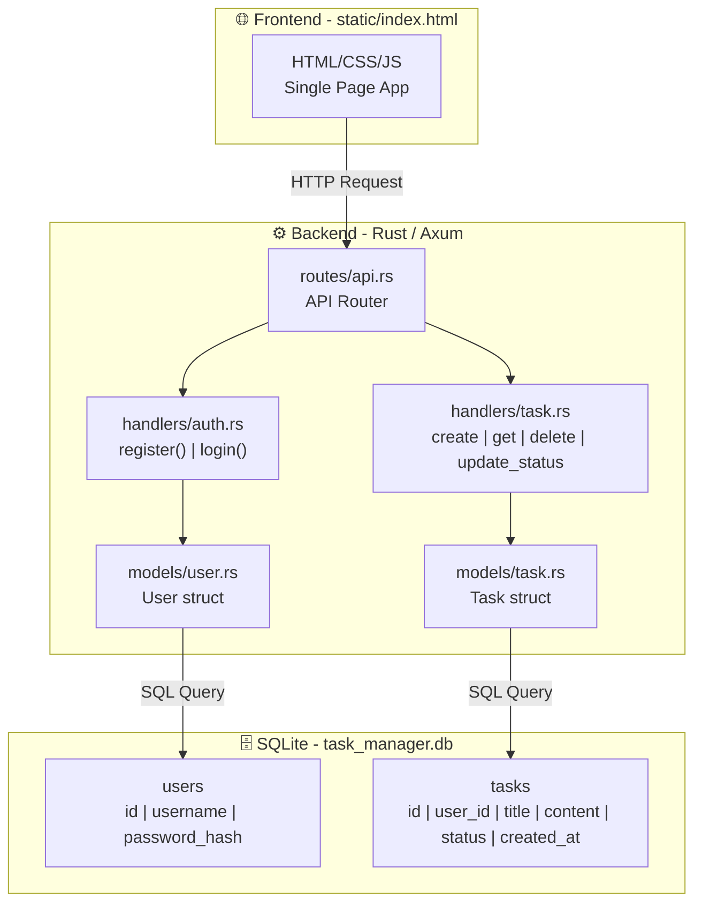
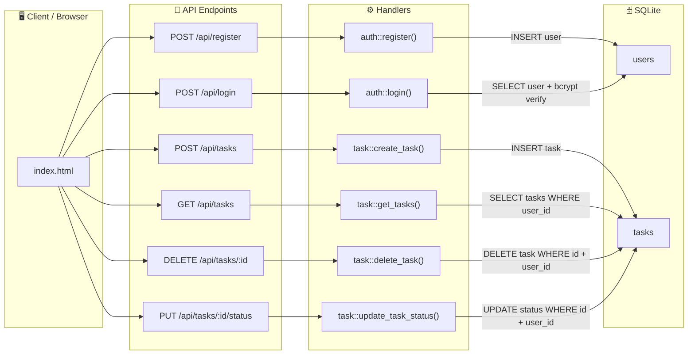
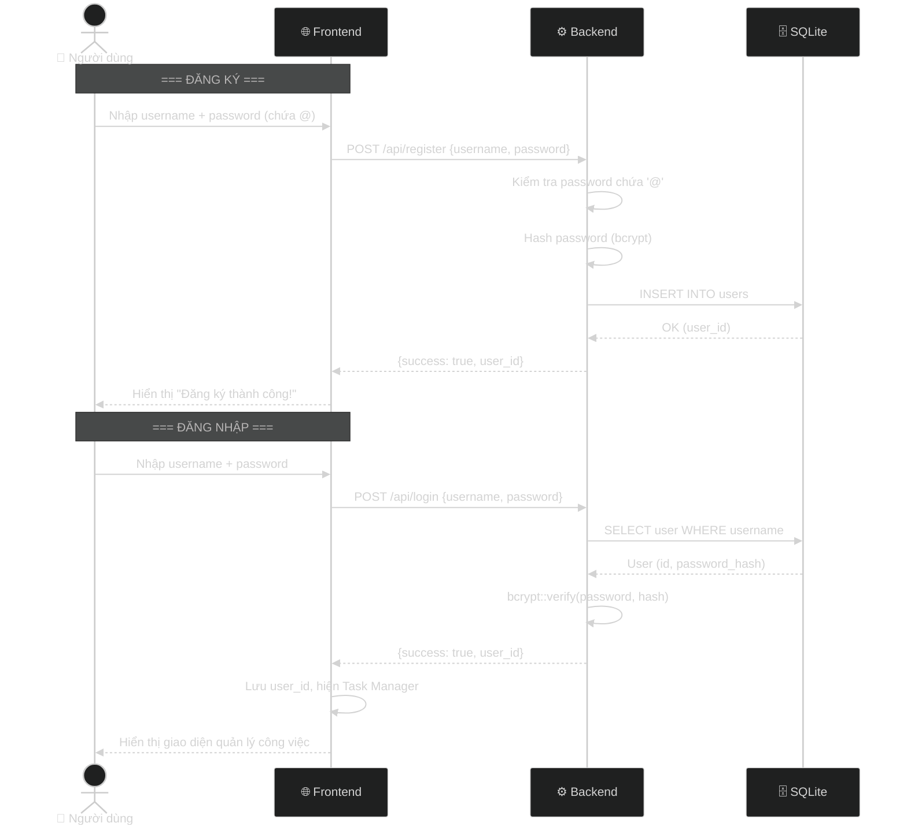
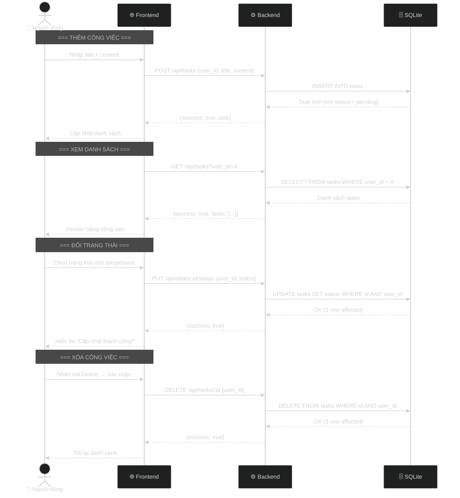

# 📊 Graphify — Task Manager Project

## 1. 🌳 Sơ đồ cây thư mục (Directory Tree)

```
baitaplon/
├── .gitignore                  # Bỏ qua target/, *.db
├── Cargo.toml                  # Khai báo thư viện phụ thuộc
├── Cargo.lock                  # Lock phiên bản thư viện
├── README.md                   # Mô tả dự án
├── README_4_10.md              # Yêu cầu bài tập lớn
│
├── src/                        # ── MÃ NGUỒN RUST ──
│   ├── main.rs                 # Entry point: khởi tạo DB, Router, Server
│   │
│   ├── models/                 # Tầng Model (dữ liệu)
│   │   ├── mod.rs              #   └── Khai báo module user, task
│   │   ├── user.rs             #   └── Struct User + create(), find_by_username()
│   │   └── task.rs             #   └── Struct Task + create(), get_by_user_id(),
│   │                           #       delete(), update_status()
│   │
│   ├── handlers/               # Tầng Handler (xử lý logic)
│   │   ├── mod.rs              #   └── Khai báo module auth, task
│   │   ├── auth.rs             #   └── register(), login()
│   │   └── task.rs             #   └── create_task(), get_tasks(),
│   │                           #       delete_task(), update_task_status()
│   │
│   └── routes/                 # Tầng Route (định tuyến API)
│       ├── mod.rs              #   └── Khai báo module api
│       └── api.rs              #   └── api_router(): gắn route ↔ handler
│
├── static/                     # ── GIAO DIỆN FRONTEND ──
│   └── index.html              # Single-page app (HTML + CSS + JS)
│
└── task_manager.db             # SQLite database (tự tạo khi chạy)
```

---

## 2. 🏗️ Kiến trúc tổng quan (Architecture Overview)



---

## 3. 🔄 Biểu đồ luồng dữ liệu API (API Data Flow)



---

## 4. 🔐 Luồng xác thực người dùng (Authentication Flow)



---

## 5. 📋 Luồng quản lý công việc (Task Management Flow)



---

## 6. 📊 Bảng tổng hợp API Endpoints

| Method   | Endpoint                | Handler                      | Mô tả                   |
| -------- | ----------------------- | ---------------------------- | ----------------------- |
| `POST`   | `/api/register`         | `auth::register()`           | Đăng ký tài khoản mới   |
| `POST`   | `/api/login`            | `auth::login()`              | Đăng nhập               |
| `POST`   | `/api/tasks`            | `task::create_task()`        | Tạo công việc mới       |
| `GET`    | `/api/tasks?user_id=X`  | `task::get_tasks()`          | Lấy danh sách công việc |
| `DELETE` | `/api/tasks/:id`        | `task::delete_task()`        | Xóa công việc           |
| `PUT`    | `/api/tasks/:id/status` | `task::update_task_status()` | Cập nhật trạng thái     |
